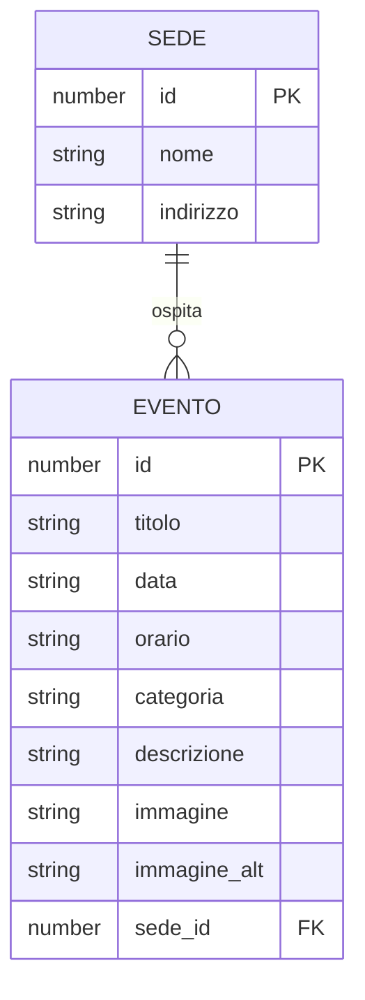

# Scheda dati — Segnale

## 1. Entità

- **Evento**: un appuntamento del festival (incontro, laboratorio o mostra).
- **Sede**: un luogo in cui si svolgono gli eventi.

## 2. Campi

### Sede (`dati/sedi.json`)

| Campo | Tipo | Esempio |
|---|---|---|
| `id` | numero | `1` |
| `nome` | testo | `Officina Nord — Sede centrale` |
| `indirizzo` | testo | `Corso Duca degli Abruzzi 24, Torino` |

### Evento (`dati/eventi.json`)

| Campo | Tipo | Esempio |
|---|---|---|
| `id` | numero | `1` |
| `titolo` | testo | `Lettere in movimento` |
| `data` | testo (data AAAA-MM-GG) | `2026-06-12` |
| `orario` | testo (HH:MM) | `10:00` |
| `categoria` | testo | `Incontro` |
| `descrizione` | testo | `Come cambia un messaggio quando cambiano le lettere? ...` |
| `immagine` | testo (percorso del file) | `assets/lettere-in-movimento.svg` |
| `immagine_alt` | testo | `Lettere geometriche disposte su una griglia` |
| `sede_id` | numero (riferimento a Sede) | `1` |

## 3. Chiavi

- **Chiave primaria**: `id` in entrambe le entità. È numerico, univoco all'interno dell'entità e stabile (non va cambiato né riutilizzato). Gli id non sono necessariamente consecutivi.
- **Chiave esterna**: `Evento.sede_id`, che fa riferimento a `Sede.id`.

## 4. Relazione

Una sede può ospitare più eventi; ogni evento si svolge in una sola sede. `Evento.sede_id` fa riferimento a `Sede.id`. Nome e indirizzo della sede sono scritti solo in `sedi.json`: gli eventi li richiamano tramite `sede_id`.

## 5. Quantità

- 6 eventi
- 3 sedi

## 6. Chi aggiorna i dati e come

Chi gestisce il sito modifica direttamente i file `dati/eventi.json` e `dati/sedi.json` nella repository e poi pubblica le modifiche su GitHub (commit e push), così le GitHub Pages si aggiornano.

## 7. Che cosa mostra la pagina

La pagina Programma legge i due file JSON e genera una scheda per ogni evento, con immagine, data, orario, categoria, titolo, descrizione e sede (nome preso da `sedi.json`). Mostra un messaggio durante il caricamento, uno quando non ci sono eventi e uno quando un file non si legge. Se un evento ha un `sede_id` inesistente, compare comunque con «Sede da definire».

## Schema Evento–Sede

